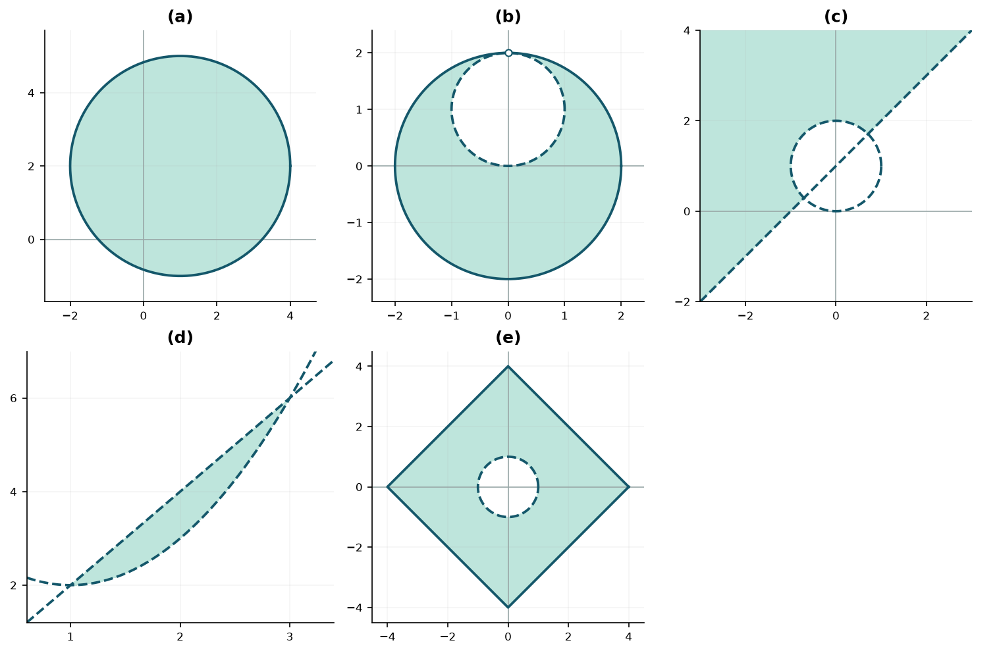
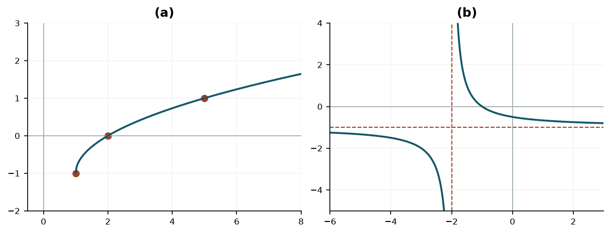
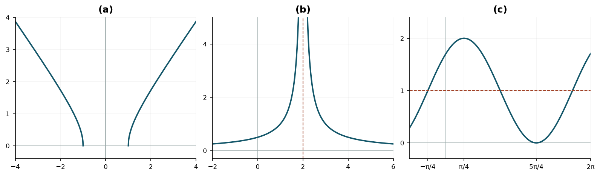
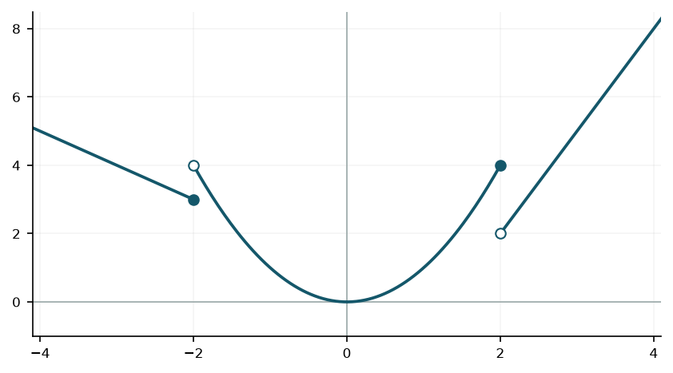

# Hafta 1 · Analitik geometri, fonksiyonlar ve limit

[Özgün soru föyü (PDF)](hafta-01.pdf)

## 1. Dik doğru ve eksen kesişimleri

$P=(-1,3)$ noktasından geçen ve $y+x+2=0$ doğrusuna dik olan doğruyu bulun. Eksenleri nerede keser?

Çözüm

Verilen doğrunun eğimi $-1$ olduğundan dik doğrunun eğimi $1$ olur. Nokta-eğim biçimi $y-3=x+1$, dolayısıyla $y=x+4$ verir. $y=0$ için $(-4,0)$, $x=0$ için $(0,4)$ bulunur. Kontrol için $x=-1$ yazınca $y=3$ elde edilir.

## 2. Eşitsizliklerin belirlediği bölgeler

Özgün föydeki (a)–(e) bölgelerini çizerken her sınırın bölgeye ait olup olmadığını işaretleyin.

Bölgeler ve çizim

**(a)** Kareye tamamlayınca $x^2+y^2-2x-4y\le4$ eşitsizliği $(x-1)^2+(y-2)^2\le9$ olur. Merkez $(1,2)$, yarıçap $3$. Diskin içini ve çemberini alın.

**(b)** $x^2+y^2\le4$ büyük kapalı disk, $x^2+(y-1)^2>1$ küçük kapalı diskin dışıdır. Büyük diskten küçük diski çıkarın. İki çemberin değme noktası $(0,2)$ çıkarılan diske aittir.

**(c)** $x^2+(y-1)^2>1$ ve $y>x+1$. Doğrunun üstünde kalan açık yarı düzlemin, merkezi $(0,1)$ olan birim çemberin dışındaki kısmını tarayın. Her iki eşitsizlik de kesindir.

**(d)** Alt sınır $y=(x-1)^2+2$, üst sınır $y=2x$. Aralarında yer olabilmesi için $x^2-4x+3=(x-1)(x-3)<0$, yani $1<x<3$ gerekir. $(1,2)$ ile $(3,6)$ arasında kalan bölgenin iki sınırı da açıktır.

**(e)** $|x|+|y|\le4$ köşeleri $(\pm4,0),(0,\pm4)$ olan kapalı bir kare verir. $x^2+y^2>1$ koşulu ortadaki kapalı birim diski çıkarır.

## 3. Grafik ötelemeleri

$y=\sqrt{x-1}-1$ ve $y=1/(x+2)-1$ grafiklerini temel grafiklerden elde edin.

Ötelemeler ve kontrol noktaları

**(a)** $\sqrt{x}$ eğrisini bir sağa, bir aşağı öteleyin. Başlangıç $(1,-1)$ olur. Eğri $(2,0)$ ve $(5,1)$ noktalarından geçer.

**(b)** $1/x$ eğrisini iki sola, bir aşağı öteleyin. Asimptotlar $x=-2$ ve $y=-1$ olur. Sağ kol $(-1,0)$, sol kol $(-3,-2)$ noktasından geçer.

## 4. Tanım kümesi, değer kümesi ve grafik

Üç fonksiyonun çözümü ve grafikleri

**(a)** $f(x)=\sqrt{x^2-1}$. Kök içi negatif olamaz, dolayısıyla $D=(-\infty,-1]\cup[1,\infty)$. $y\ge0$ için $x=\sqrt{1+y^2}$ seçilebilir, böylece değer kümesi $[0,\infty)$ olur. Grafik $x^2-y^2=1$ hiperbolünün $y\ge0$ kısmıdır.

**(b)** $f(x)=1/|2-x|$. Payda $x=2$ dışında pozitiftir. $D=\mathbb R\setminus\{2\}$, değer kümesi $(0,\infty)$. İki kol $x=2$ doğrusuna göre simetriktir. $|x|\to\infty$ iken $f(x)\to0$.

**(c)** $y=1+\sin(x+\pi/4)$. Tanım kümesi $\mathbb R$, değer kümesi $[0,2]$. Orta çizgi $y=1$, periyot $2\pi$. Bir periyot $(-\pi/4,1)$ noktasında yükselerek başlar, $(\pi/4,2)$ tepesinden ve $(5\pi/4,0)$ çukurundan geçer.

## 5. Fonksiyon bileşkesi

İki bileşke

**(a)** $f(x)=x+1/x$, $g(x)=(x-1)/(x+3)$. İç fonksiyon $x=-3$ için tanımsızdır. Dış fonksiyonun girdisi sıfır olamayacağı için $x=1$ de çıkarılır. Kalan noktalarda

$$
(f\circ g)(x)=\frac{x-1}{x+3}+\frac{x+3}{x-1}
=\frac{(x-1)^2+(x+3)^2}{(x+3)(x-1)}.
$$

**(b)** $F(x)=\sin^2(x-5)$ için işlem sırası beş çıkarma, sinüs alma ve kare almadır. Bu yüzden $h(x)=x-5$, $g(t)=\sin t$, $f(u)=u^2$ seçimi $F=f\circ g\circ h$ verir.

## 6. Parçalı fonksiyon grafiği

Üç parça ve uç noktaları

- $x\le-2$ boyunca $y=1-x$ doğrusunu çizin. $(-2,3)$ kapalıdır.
- $-2<x\le2$ boyunca $y=x^2$ parabolünü çizin. $(-2,4)$ açık, $(2,4)$ kapalıdır.
- $x>2$ boyunca $y=3x-4$ doğrusunu çizin. $(2,2)$ açıktır.

## 7. Teklik ve çiftlik

Dört fonksiyon için simetri testi

Sırasıyla $f(-x)$ ile $f(x)$ ve $-f(x)$ ifadelerini karşılaştırın.

1. $x/(x^2+1)$ **tektir**. Pay işaret değiştirir, payda aynı kalır.
2. $3x-1$ **ne tek ne çifttir**. $-3x-1$ ifadesi ne $3x-1$ ne de $-3x+1$ ile özdeştir.
3. $x+x^3+x^5$ **tektir**. Üç terim de işaret değiştirir.
4. $\sec(x^2+1)$ **çifttir**. İç ifade $x\mapsto -x$ altında değişmez ve tanım kümesi de simetriktir.

## 8. Dokuz limit

Çözümler ve yaklaşım yönleri

**(a)** $x\to-3$ iken $(x^2-9)/(x-3)=x+3\to0$. Payda $-6$ olduğundan doğrudan yerine koymak da geçerlidir.

**(b)** $x\to1$ için $t=\sqrt{x}\to1$ alın. $x-4\sqrt{x}+3=(t-1)(t-3)$ ve $x^2-1=(t-1)(t+1)(t^2+1)$. Ortak çarpanı attıktan sonra limit $-2/(2\cdot2)=-1/2$ olur.

**(c)** $x\to-2$ için $1/x+1/2=(x+2)/(2x)$ ve $x^3+8=(x+2)(x^2-2x+4)$. Bölümün limiti $1/[2(-2)\cdot12]=-1/48$.

**(d)** $t=\sqrt[3]{7+x}$ yazınca $(t-2)(t^2+2t+4)=x-1$. Böylece $(t-2)/(x^2-1)=1/[(t^2+2t+4)(x+1)]\to1/24$.

**(e)** $|(x-1)^2\cos(3/(x-1))|\le(x-1)^2\to0$. Sıkıştırma ile limit $0$.

**(f)** $1/(x-2)^2-1/(x-2)=(3-x)/(x-2)^2$. $x\to2$ iken pay $1$'e, payda pozitif taraftan sıfıra gider. Limit $+\infty$.

**(g)** $\sqrt{x^4-x^2}$ için $x^2(x^2-1)\ge0$ şarttır. Tanım kümesi $(-\infty,-1]\cup\{0\}\cup[1,\infty)$. $0$ izole noktadır. Delinmiş bir komşulukta yaklaşılabilecek tanımlı nokta olmadığından $x\to0$ limiti tanımlanmaz.

**(h)** Aynı fonksiyonda $1$'e tanım kümesinden yalnız sağdan yaklaşılır. $x\to1^+$ için kök içi $0$'a, dolayısıyla karekök de $0$'a gider. Tanım kümesine göre limit $0$'dır. Dersin iki taraflı limit tanımı iki tek taraflı limit gerektiriyorsa sol limit bulunmadığından iki taraflı limit yoktur.

**(i)** $x=2$ yakınında $6x-11>0$, $x-3<0$, $2x-5<0$. Pay $(6x-11)-(3-x)=7(x-2)$, payda $(3-x)-(5-2x)=x-2$. $x\ne2$ için oran $7$ olduğundan limit $7$.

