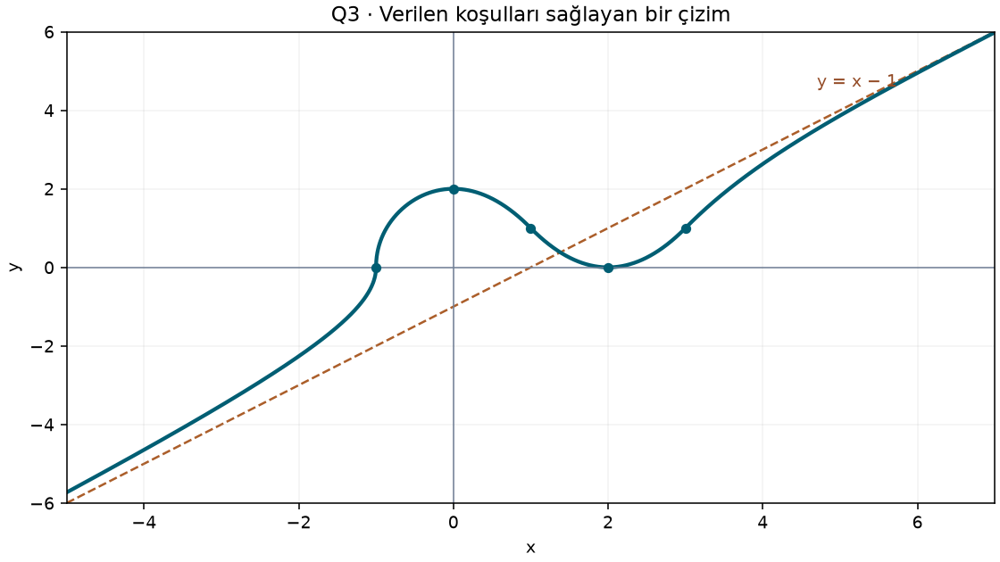
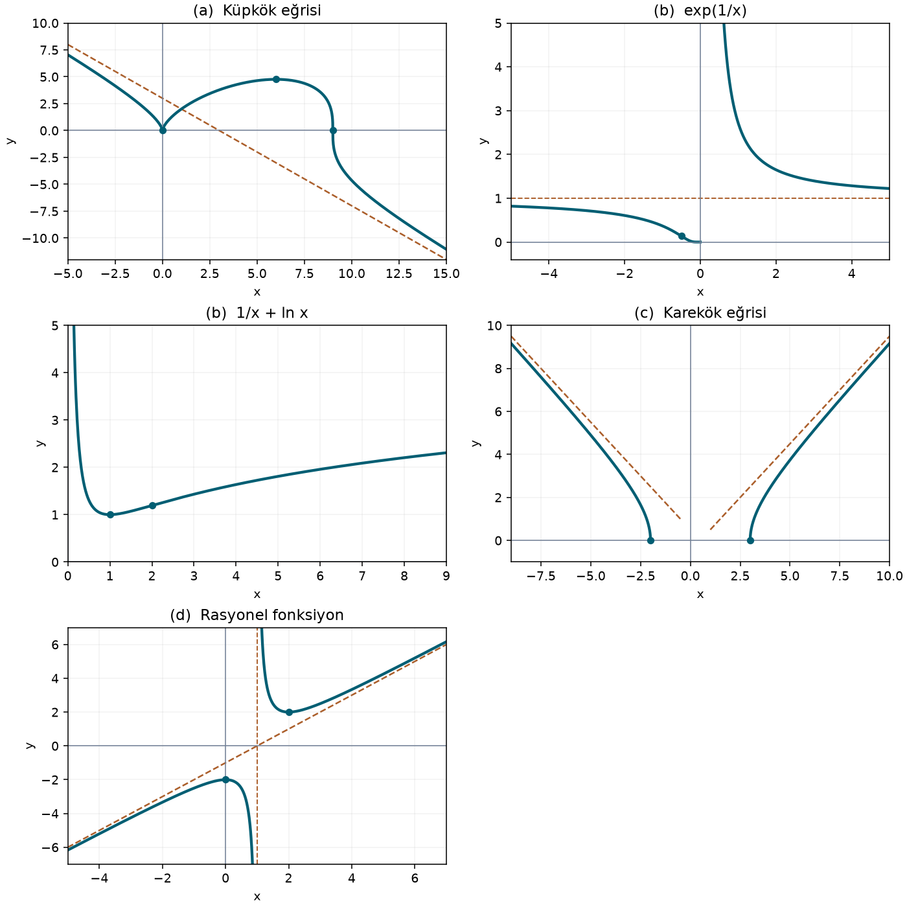

# Hafta 7 · Ekstremumlar, konkavlık ve grafik çizimi

**Kapsam.** Q1–Q4, MT2'nin ekstremum, konkavlık, büküm ve grafik çizimi başlıklarıyla örtüşür. Bir grafiği çizerken önce tanım kümesini, sonra $f'$ ve $f''$ işaret aralıklarını belirle. [Özgün soru kâğıdı](hafta-07.pdf)

## Q1 · Durağan ve tekil noktaları sınıflandırma

**(a)** $f=(x^2-2)e^x$, **(b)** $g=x^{1/3}(x-4)$. Türevin sıfır olduğu ve fonksiyon tanımlıyken türevin bulunmadığı noktaları ayrı ayrı incele.

Çözümü aç

**(a)** $f'=e^x(x^2+2x-2)$. Kökler $a=-1-\sqrt3$ ile $b=-1+\sqrt3$ ve işaretler sırasıyla $+,-,+$. $(a,-2ae^a)$ yerel maksimum, $(b,-2be^b)$ yerel minimumdur. Ordinatlar için köklerde $x^2-2=-2x$ kullanıldı. Tekil nokta yoktur.

**(b)** $x\ne0$ için $g'=4(x-1)/(3x^{2/3})$. Payda pozitif olduğundan 1'in solunda azalır, sağında artar. $(1,-3)$ minimumdur, üstelik $g(x)\to+\infty$ iki uçta da geçerlidir. $(0,0)$ tekil bir noktadır. Fark oranı $(g(h)-g(0))/h=(h-4)/h^{2/3}\to-\infty$ olduğundan burada düşey teğet vardır. Azalma iki tarafta sürdüğü için ekstremum oluşmaz.

## Q2 · Mutlak maksimum ve minimum

**(a)** $\sin^2x+\cos x$ için $[\pi/6,3\pi/4]$, **(b)** $(x+2)^{1/3}(x-7)^{2/3}$ için $[-1,8]$, **(c)** $x/\sqrt{x^4+1}$ için $\mathbb R$ üzerinde mutlak uç değerleri bul.

Adayları ve değer karşılaştırmalarını aç

**(a)** $f'=\sin x(2\cos x-1)$. İçerideki tek kök $\pi/3$. Soldaki uçta değer $1/4+\sqrt3/2$, kritik noktada $5/4$, sağdaki uçta $1/2-\sqrt2/2$. En büyük değer $5/4$, en küçük değer $(1-\sqrt2)/2$.

**(b)** $x\ne7$ için aralık içinde

$$g'(x)=\frac{x-1}{(x+2)^{2/3}(x-7)^{1/3}}.$$

Adaylar uçlar $-1,8$, durağan sayı $1$ ve tekil sayı $7$. Değerler $g(-1)=4$, $g(8)=\sqrt[3]{10}$, $g(1)=\sqrt[3]{108}$ ve $g(7)=0$. Maksimum $\sqrt[3]{108}$ ($x=1$), minimum $0$ ($x=7$).

**(c)** $h'=(1-x^4)/(x^4+1)^{3/2}$. $|x|>1$ için negatif, $|x|<1$ için pozitif. İki uçta da $h(x)\to0$, bu nedenle $(1,1/\sqrt2)$ mutlak maksimum, $(-1,-1/\sqrt2)$ mutlak minimumdur. Açık ve sınırsız bir aralıkta da bu uç değerler fiilen alınır.

## Q3 · Verilerden grafik oluşturma

Sürekli $f$, yalnız $x=-1$'de türevlenemiyor. $x=-1,0,1,2,3$ için değerler sırasıyla $0,2,1,0,1$. İki sonsuzda $f(x)+1-x\to0$. Türev $(-\infty,-1),(-1,0),(2,\infty)$ üzerinde pozitif, $(0,2)$ üzerinde negatif ve $x\to-1$ iken $f'(x)\to+\infty$. İkinci türev $(-\infty,-1),(1,3)$ üzerinde pozitif, $(-1,1),(3,\infty)$ üzerinde negatif. Kritik noktaları belirle ve bir eskiz çiz.

Adım adım eskizi aç

Önce her iki uçtaki eğik asimptotu $y=x-1$ olarak çiz ve verilen beş noktayı işaretle. Soldan $(-1,0)$'a doğru artarak ve yukarı konkav biçimde gel. İki yandan eğim $+\infty$ olduğu için burada teğet $x=-1$'dir. Sağa geçince artış sürer, konkavlık aşağı döner. $(0,2)$'de yatay teğetle yerel maksimuma ulaşılır.

$(0,2)$ noktasından $(2,0)$ noktasına kadar azalırken $(1,1)$'de aşağı konkavlıktan yukarı konkavlığa geç. $(2,0)$ yatay teğetli yerel minimumdur. Buradan $(3,1)$'e kadar artarak ve yukarı konkav ilerle, sonrasında artarak ve aşağı konkav biçimde asimptota yaklaş.

Kritik sayılar $-1,0,2$. Büküm noktaları $(-1,0),(1,1),(3,1)$. $x=-1$ hem tekil hem büküm noktasıdır. Sonsuzlardaki eğik asimptot nedeniyle mutlak ekstremum yoktur.

## Q4 · Formülden grafik çizme

**(a)** $x^{2/3}(9-x)^{1/3}$, **(b)** $e^{1/x}$ veya $1/x+\ln x$, **(c)** $\sqrt{x^2-x-6}$, **(d)** $(x^2-2x+2)/(x-1)$. Föyde (b) için iki seçenek verilir. Her iki grafiğin analizi aşağıdadır.

Türevleri, grafik özelliklerini ve eskizleri aç

**(a)** Tüm gerçel sayılarda tanımlı; kökler $0,9$. Bu noktaların dışında

$$f'=\frac{6-x}{\sqrt[3]x\,(9-x)^{2/3}},\qquad f''=\frac{-18}{x^{4/3}(9-x)^{5/3}}.$$

Sırasıyla $(-\infty,0)$'da azalır, $(0,6)$'da artar, $(6,9)$ ve $(9,\infty)$'da azalır. $(0,0)$ sivri yerel minimumdur. $(6,\sqrt[3]{108})$ yerel maksimumdur. $x<9$ için $0$ hariç $f''<0$, $x>9$ için $f''>0$. $(9,0)$ düşey teğetli büküm noktasıdır. Uçlarda $f=-x(1-9/x)^{1/3}=-x+3+o(1)$ olduğundan asimptot $y=-x+3$.

**(b), $e^{1/x}$ seçeneği.** Tanım kümesi $\mathbb R\setminus\{0\}$. $f'=-e^{1/x}/x^2<0$, her dal azalır. Soldan $x\to0^-$ iken $f\to0$, sağdan $f\to\infty$. Asimptotlar $x=0$ ve $y=1$. $f''=e^{1/x}(1+2x)/x^4$ olduğundan $x<-1/2$ için aşağı, $(-1/2,0)$ ve $(0,\infty)$ için yukarı konkavdır. Büküm $(-1/2,e^{-2})$. Grafik eksenlere değmez.

**(b), $1/x+\ln x$ seçeneği.** $x>0$, $f'=(x-1)/x^2$. $(0,1)$'de azalır, $(1,\infty)$'de artar. $(1,1)$ mutlak minimumdur. $x\to0^+$ için $1/x$ baskın olduğundan $f\to+\infty$ ve $x=0$ düşey asimptottur. $x\to\infty$ için $f\to+\infty$. $f''=(2-x)/x^3$ olduğundan $(2,1/2+\ln2)$'de yukarı konkavlıktan aşağı konkavlığa geçer.

**(c)** $(x-3)(x+2)\ge0$ gerektirir. Dallar $(-\infty,-2]$ ve $[3,\infty)$ üzerinde kalır. İç kısımlarda

$$f'=\frac{2x-1}{2\sqrt{x^2-x-6}},\qquad f''=-\frac{25}{4(x^2-x-6)^{3/2}}.$$

Sol dal azalarak $(-2,0)$'a gelir; sağ dal $(3,0)$'dan artarak uzaklaşır. İki kökte tek yanlı düşey teğet ve mutlak minimum vardır. İki dal da aşağı konkavdır. Karekökü $|x|\sqrt{1-1/x-6/x^2}$ diye yazınca eğik asimptotlar solda $y=-x+1/2$, sağda $y=x-1/2$ olur.

**(d)** Bölme işlemi $f=x-1+1/(x-1)$ verir. Asimptotlar $x=1$ ve $y=x-1$. Pay $(x-1)^2+1$ pozitif olduğu için gerçek kök yok, $y$ kesişimi $(0,-2)$. $f'=1-1/(x-1)^2$ ile $(-\infty,0)$ ve $(2,\infty)$'da artış, $(0,1)$ ve $(1,2)$'de azalış bulunur. $(0,-2)$ yerel maksimum, $(2,2)$ yerel minimumdur. $f''=2/(x-1)^3$ solda negatif, sağda pozitiftir. $x=1$ tanım kümesine girmediği için büküm noktası yoktur.

